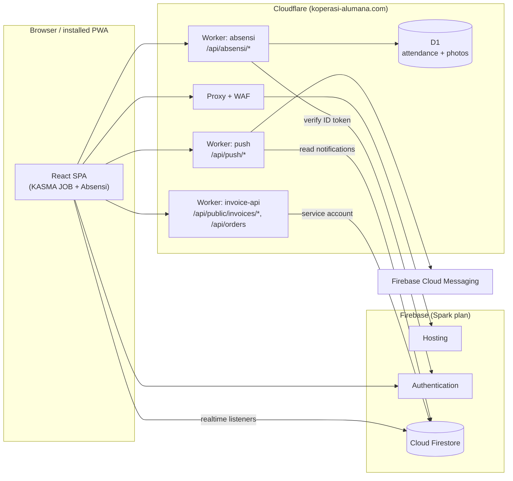

<div align="center">


# Al-Umanaa Koperasi Platform

**One installable web app that runs the daily operations of Koperasi Al-Umanaa: catering orders and delivery, the MBG (Makan Bergizi Gratis) school-meal program, staff KPIs, and employee attendance.**

[](https://react.dev/)
[](https://www.typescriptlang.org/)
[](https://vite.dev/)
[](https://tailwindcss.com/)
[](https://firebase.google.com/)
[](https://workers.cloudflare.com/)
[](https://web.dev/explore/progressive-web-apps)
[](https://vitest.dev/)

</div>

---

## Contents

- [What it does](#what-it-does)
- [Architecture](#architecture)
- [Repository layout](#repository-layout)
- [Roles](#roles)
- [Getting started](#getting-started)
- [Testing](#testing)
- [Deployment](#deployment)
- [Design notes](#design-notes)

---

## What it does

The app has two entrances on the same domain and PWA: **KASMA JOB** for operations staff and customers, and **Absensi** for employee attendance. Each role sees only its own menus.

### 🛒 Koperasi orders and delivery

- Order intake, a product catalog with photos, invoices, and promos.
- Production queue and history, a delivery scheduler, and handover to couriers.
- Live courier GPS tracking, plus a proof-of-delivery camera that stamps the location and server time on each photo.
- The recipient signs on screen. Customers can also open and sign their invoice through a public link.
- Checkout prices are recalculated on the server (Cloudflare Worker), never trusted from the browser.
- Orders past their delivery deadline are flagged with a red dot in the sidebar.

### 🍱 Catering job desk

- The MO plans daily job desks, Teklap teams carry them out, and Co-MO reviews the results.

### 🏫 MBG program (Makan Bergizi Gratis)

| Stage | What happens |
| --- | --- |
| **Admin MBG** | Imports the beneficiary (PM) list from an Excel workbook or a Google Sheets link, plans menus, and submits the batch for the day. |
| **Persiapan & Purchasing** | Ingredient preparation, purchase orders, supplier records, and purchasing recaps. |
| **Produksi MBG** | Production data per batch, nutrition (TKPI) and recipe adjustments, daily reports, and photo documentation of ingredients. |
| **Distribusi MBG** | Assigns schools to couriers and corrects delivery evidence. |
| **Kurir MBG** | Records four proof photos per school: arrival, handover, delivery note, and container pickup. |
| **Arsip PM** | Archive of every batch, searchable by date, school, or courier. |

Official reports are generated on the device as **PDF and Word (.docx)**, including the multi-page delivery documentation with photos.

### 🕒 Absensi (employee attendance)

A separate attendance app. Employees clock in and out from their own phones. A record is accepted only when **all** of these checks pass:

1. **Passkey**: fingerprint or Face ID built into the phone (WebAuthn).
2. **Live selfie** that matches the employee's reference face. Matching runs on the device with `face-api`.
3. **Location** inside the building's drawn polygon, not a loose radius.
4. **Server time**: the phone's clock is never used.

Every check is automatic, so no admin has to approve each clock-in.

| Employees | Attendance admin |
| --- | --- |
| Clock in and out, with status and time shown on the button | **Hari Ini**: live attendance for the day |
| Attendance history | **Karyawan**: employee accounts and face-check exemptions |
| Leave, sick-leave, and permission requests | **Area**: draw the allowed building polygon on a map |
| Shift-swap requests | **Persetujuan**: approve leave and shift requests |
| In-app notifications and profile | **Rekap**: export to Excel (.xlsx) or Word (.docx) |

Absensi runs entirely on a Cloudflare Worker with **D1** and does not use Firestore at all, so attendance keeps working even if the Firestore daily quota runs out.

### 📊 KPI, tasks, and control centers

- **KPI & Task Unit**: unit heads assign tasks with deadlines and review the evidence.
- **Performa Saya**: personal performance for each staff member.
- **Control Center SDM** for the super admin, and a **Developer Control Center** with a recycle bin for restoring deleted records.

### 📱 Platform

- **Installable PWA** with an offline-capable Firestore cache.
- **Update gate**: after a deploy, a full-screen prompt asks users to press **Perbarui**, so every phone moves to the new version.
- **Push notifications** to phones through Firebase Cloud Messaging, sent by a Cloudflare Worker.

---

## Architecture



- The React app talks to Firestore directly, and **security rules** decide what each role can read and write.
- The Workers handle only what must not run in the browser: push delivery, public invoice access, server-side checkout pricing, and attendance.

---

## Repository layout

| Path | Contents |
| --- | --- |
| [`frontend/`](frontend) | React + TypeScript PWA (Vite, Tailwind CSS 4) |
| `frontend/src/absensi/` | The Absensi app: pages, device checks (passkey, selfie, face, GPS), admin tabs, exports |
| `frontend/src/pages/mbg/`, `frontend/src/pages/katering/` | MBG and catering screens |
| `frontend/src/__tests__/` | Unit, component, and Firestore rules tests |
| [`workers/absensi/`](workers/absensi) | Attendance Worker, D1 migrations, and seed scripts |
| [`workers/push/`](workers/push) | Push notification Worker (FCM) with a cron safety net |
| [`workers/invoice-api/`](workers/invoice-api) | Public invoice and checkout Worker |
| [`firestore.rules`](firestore.rules), [`firestore.indexes.json`](firestore.indexes.json) | Firestore security rules, composite indexes, and index exemptions for photo fields |
| `backend/`, `k8s/`, `docker-compose*.yml` | A Go API with Docker and Kubernetes manifests. **The live system doesn't use it**: production runs on Firebase and Cloudflare Workers. |
| `docs/` | Design specs and testing notes |

---

## Roles

Access is controlled per role in [`firestore.rules`](firestore.rules) and in the app's navigation.

| Area | Roles |
| --- | --- |
| Koperasi orders | `admin`, `monitoring`, `tim_produksi`, `distribusi`, `kurir`, customers |
| Catering job desk | `mo_katering`, `co_mo_katering`, `produksi_1/2`, `distribusi_1/2` |
| MBG | `admin_mbg`, `produksi_mbg`, `distribusi_mbg`, `kurir_mbg`, and the `mbg2` team roles |
| KPI & tasks | `kepala_unit`, `tim_unit` |
| Administration | `super_admin`, `developer` |
| Absensi | `admin_absensi`, `absen_karyawan` (separate accounts, set as a custom claim) |

---

## Getting started

**Prerequisites:** Node.js 20+, the [Firebase CLI](https://firebase.google.com/docs/cli), and (for the Workers) [Wrangler](https://developers.cloudflare.com/workers/wrangler/).

```bash
git clone https://github.com/gariiriana/Al---Umana-Koperasi.git
cd Al---Umana-Koperasi/frontend
npm install
```

### Run locally against the emulators (recommended)

Nothing in this mode touches the live project.

1. Create `frontend/.env.emulator` with `VITE_USE_EMULATORS=true`, a `demo-*` project ID, and placeholder Firebase web keys.
2. Start the emulators from the repo root:

   ```bash
   firebase emulators:start --only auth,firestore --project demo-alumana
   ```

3. Start the app:

   ```bash
   cd frontend && npx vite --mode emulator
   ```

4. To work on Absensi, also start its Worker. The step-by-step guide, seed accounts, and fake-GPS tips are in [`workers/absensi/README.md`](workers/absensi/README.md).

   ```bash
   cd workers/absensi
   cp .dev.vars.example .dev.vars
   npm run db:migrate:local
   npm run dev
   ```

### Environment variables

The frontend reads `VITE_FIREBASE_*` (the Firebase web config), `VITE_TURNSTILE_SITE_KEY`, and the optional Worker base URLs (`VITE_PUSH_API_BASE_URL`, `VITE_INVOICE_API_BASE_URL`). Keep real values in untracked `.env.*` files. Worker secrets (service-account keys, FCM credentials) belong in `wrangler secret`, never in the repo.

---

## Testing

```bash
# Frontend: unit, component and property-based tests (Vitest + Testing Library + fast-check)
cd frontend && npm test

# Firestore security rules on the emulator (from the repo root)
npm run test:courier-rules

# Workers
cd workers/absensi && npm test
cd workers/push && npm test
```

---

## Deployment

```bash
cd frontend && npm run build

# From the repo root. Deploy new indexes first and wait until they finish building.
npx firebase-tools deploy --only firestore:indexes --project al-umana-koperasi
npx firebase-tools deploy --only firestore:rules,hosting --project al-umana-koperasi

# Each Worker (absensi, push, invoice-api)
cd workers/push && npm run deploy
```

After a hosting deploy, open apps show the **Perbarui** prompt and switch to the new version once it is pressed.

---

## Design notes

- **Built for Firebase's free Spark plan.** Every growing query has a bound and an order: date windows, `orderBy` with `limit`, and `limit(1)` existence checks for indicator dots. Identical listeners are shared, and the Firestore persistent cache absorbs repeat reads.
- **Photos are stored as compressed base64 in Firestore** (no Cloud Storage), and photo fields are exempt from indexing. Large files are split into chunk subcollections to stay under the 1 MiB document limit.
- **Mission-critical attendance is isolated** on Cloudflare D1, so a Firestore outage or exhausted quota can't block clock-ins.
- **Reports are generated on the device** (jsPDF, docx, SheetJS), so no generated file is ever stored.

---

<div align="center">

Built for **Koperasi Al-Umanaa** · Pondok Pesantren Al-Umanaa, Sukabumi

</div>
